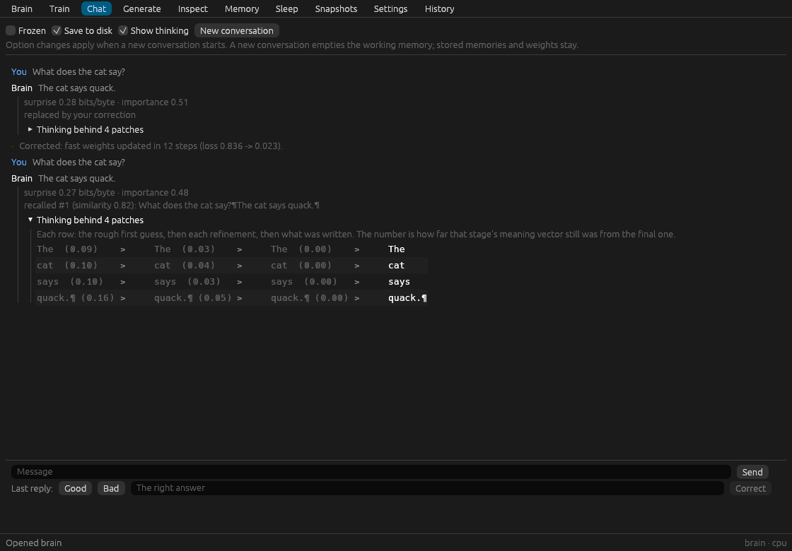

# Thingamaroo

A small language model, written in Rust, that reads and writes raw bytes,
thinks in meaning space before it writes, and keeps learning from conversation
after its first training.

It comes as two applications over one core library:

- **`thingamaroo`**: a command-line application.
- **`thingamaroo-gui`**: a desktop application that can do everything the
  command-line application can.

This is a hobby-scale research system, not a chatbot. The goal is readable
text plus learning you can watch happen: correct it, see the correction stick,
let it sleep, and see the correction survive.



## Contents

- [What it does](#what-it-does)
- [Building](#building)
- [Five-minute tour (command line)](#five-minute-tour-command-line)
- [Five-minute tour (desktop application)](#five-minute-tour-desktop-application)
- [Documentation](#documentation)
- [Training on your own text](#training-on-your-own-text)
- [Model sizes and hardware](#model-sizes-and-hardware)
- [How it works, briefly](#how-it-works-briefly)
- [Project layout](#project-layout)
- [Tests](#tests)
- [Limitations](#limitations)
- [Credits and license](#credits-and-license)

## What it does

1. **Receives** input as raw bytes. There is no tokenizer and no vocabulary.
2. **Processes by thought**: predicts a rough meaning vector for what comes
   next, refines it over a few internal steps, then writes exact bytes.
3. **Stores** what it experiences, weighted by how surprising it was.
4. **Changes future outcomes** from what it stored: right away through recalled
   memories and fast weights, and permanently through sleep.

Tried on the smallest size (1.3M parameters, trained for 14 minutes on four
CPU cores with the pure-Rust backend on the built-in sample text):

```
you> What does the cat say?
bot> The cat says meow.
you> /correct The cat says quack.
  fast weights updated in 12 steps (loss 0.836 -> 0.023)
you> What does the cat say?
bot> The cat says quack.
you> /sleep
  memories   loss 0.836 -> 0.017
  old skills loss 0.527 -> 0.533
  fast weights reset; 0 memories pruned, 1 remain
```

After that sleep, with the fast weights reset and memory recall switched off,
it still answers "The cat says quack.", and still answers "The dog says woof."
and "The owl eats mice."

## Building

You need:

- **Rust 1.95 or newer** (install from <https://rustup.rs>).
- **A C and C++ compiler**, for the bundled memory allocator and the LibTorch
  bindings. Linux and macOS have one once the usual build tools are
  installed; on Windows the MSVC build tools that Rust already requires are
  enough.
- **About 1 GB of free disk** for LibTorch (see below).

From the project folder:

```
cargo build --release
```

The first build downloads and compiles the dependencies and takes several
minutes. It produces two programs:

```
target/release/thingamaroo        command-line application
target/release/thingamaroo-gui    desktop application
```

(On Windows they end in `.exe`.)

The examples in this project write `thingamaroo` and `thingamaroo-gui` for
short. Either run them by path (`target/release/thingamaroo ...`), copy the two
programs somewhere on your `PATH`, or install them with
`cargo install --path crates/cli` and `cargo install --path crates/gui`.

### LibTorch (on by default)

The default build trains on the processor through **LibTorch**, the C++
engine inside PyTorch. No Python is involved: the Rust code calls LibTorch's
compiled maths routines directly. It trains about twice as fast as the
pure-Rust backend (measured on four CPU cores, identical results):

| Size, run | Pure Rust (`cpu`) | LibTorch (`libtorch`) | Speedup |
| --- | --- | --- | --- |
| `tiny`, 150 steps × 12 sequences | 84 s (~720 patches/s) | 39 s (~1,600 patches/s) | 2.2× |
| `prototype`, 8 steps × 4 sequences | 77 s (~64 patches/s) | 30 s (~170 patches/s) | 2.6× |

**Getting LibTorch.** The first build downloads the processor version of
LibTorch 2.9.0 (180 MB, 786 MB unpacked) from download.pytorch.org into the
build folder. To use a copy you already have, or if the download is blocked
(for example behind a company proxy), download
`libtorch-shared-with-deps-2.9.0+cpu.zip` yourself from
<https://download.pytorch.org/libtorch/cpu/>, unpack it, and point the build
at it:

```
export LIBTORCH=/path/to/libtorch      # Windows: set LIBTORCH=C:\path\to\libtorch
cargo build --release
```

**Running.** On Linux and macOS the build records where LibTorch is, so the
programs start without further setup, as long as that folder stays where it
was. On Windows, add LibTorch's `lib` folder to `PATH` (or copy its `.dll`
files next to the programs) before starting them.

**Pure-Rust build.** To build without LibTorch (nothing to download, a single
self-contained program, about half the training speed):

```
cargo build --release --no-default-features --features fast-allocator
```

Drop `--features fast-allocator` too if no C compiler is available; that
halves CPU training speed again.

Burn, the tensor library this project uses, has marked its LibTorch backend
as deprecated in favour of its newer backends. It works in the Burn version
this project pins (0.22.1); a future upgrade of Burn may mean switching the
default back to a pure-Rust backend. Burn's suggested replacement for the
processor (its CubeCL `cpu` backend) was tried: it needed its own 45 MB LLVM
download, took ten minutes to build, and had not finished 10 training steps of
`tiny` after eight minutes, so it is not used.

### Using a graphics card

For anything larger than `tiny`, a graphics card matters far more than the
processor backend. Build with a GPU backend:

```
cargo build --release -p thingamaroo-cli -p thingamaroo-gui --features gpu
```

| Feature | Backend | Needs |
| --- | --- | --- |
| `libtorch` *(default)* | The processor through LibTorch | the LibTorch download above |
| `gpu` | Any graphics card through Vulkan, Metal or DirectX 12 | up-to-date graphics drivers |
| `cuda` | NVIDIA cards through CUDA | the CUDA toolkit installed |
| *(always)* | The processor, pure Rust | nothing extra |

`--device auto` (the default) picks the fastest backend that is built in and
has hardware: a graphics card (`cuda`, then `gpu`), then `libtorch`, then
`cpu`. Any of them can be chosen by name with `--device`. A GPU build compiles
many more dependencies; expect it to take about three times as long as the
default build.

### Linux desktop libraries

The desktop application needs the usual desktop libraries at run time. A
minimal installation may lack one of them; on Debian or Ubuntu:

```
sudo apt install libxkbcommon-x11-0
```

## Five-minute tour (command line)

```
# 1. Make some text to learn from, and a small brain.
thingamaroo sample-corpus sample.txt
thingamaroo --brain my-brain init --preset tiny

# 2. Train it. Roughly 7 minutes on four CPU cores (14 with the pure-Rust build);
#    Ctrl-C stops early and saves.
thingamaroo --brain my-brain train --data sample.txt --steps 1500 --batch 12

# 3. Look inside.
thingamaroo --brain my-brain status
thingamaroo --brain my-brain roundtrip "The cat fell to the ground."
thingamaroo --brain my-brain generate "The cat " --thoughts

# 4. Talk to it, correct it, and let it sleep.
thingamaroo --brain my-brain chat
```

Inside `chat`, try:

```
What does the cat say?
/correct The cat says quack.
What does the cat say?
/memories
/sleep
What does the cat say?
/quit
```

Type `/help` in the conversation for every command, and see
[docs/cli.md](docs/cli.md) for the whole command line.

## Five-minute tour (desktop application)

```
thingamaroo-gui
```

1. **Brain** tab: choose a folder, pick the `tiny` size, press *Create in the
   folder above*. Press *Write sample text* to get a training file.
2. **Train** tab: put the sample file's path in the box, set *Steps* to 1500
   and *Sequences per batch* to 12, press *Start training*, and watch the curves.
3. **Chat** tab: ask "What does the cat say?", type the right answer in the
   bottom field and press *Correct*, then ask again.
4. **Sleep** tab: press *Sleep now* and compare the loss on memories and on old
   skills before and after.
5. **Snapshots** tab: roll back to how things were before the sleep.

[docs/gui.md](docs/gui.md) walks through every tab with screenshots.

## Documentation

| Document | What is in it |
| --- | --- |
| [docs/cli.md](docs/cli.md) | Every command and option of `thingamaroo`, with real example output, the commands inside `chat`, and how to read the numbers. |
| [docs/gui.md](docs/gui.md) | Every tab of `thingamaroo-gui` with screenshots, a table of command-line equivalents, and troubleshooting. |
| [docs/settings.md](docs/settings.md) | Every setting with its default and what it does. Generated by `thingamaroo settings reference`. |
| [docs/architecture.md](docs/architecture.md) | How the model, the memory and the three kinds of learning work, what is stored on disk, and what has and has not been verified. |

The tools also document themselves:

- `thingamaroo --help` and `thingamaroo <command> --help` describe every command and option.
- `thingamaroo settings show` lists every setting with its value and an explanation.
- `/help` inside `chat` lists the conversation commands.
- In the desktop application, each tab explains its controls, and the Settings
  tab shows the explanation beside each setting.
- `cargo doc --no-deps --open` builds the API documentation of the core library.

## Training on your own text

`train --data` accepts any number of files and folders. Folders are searched
recursively, and every file is read as raw bytes, so any language works.
Files are sampled with short random reads and never loaded whole, so the text
can be far larger than memory.

Two things matter for conversation:

- **One utterance per line.** A turn is your line followed by a line break, and
  the reply ends at the first line break the model writes. Text made of
  question lines followed by answer lines teaches it to answer.
- **Speaker marks, if your data has them.** If lines look like `User: ...` and
  `Bot: ...`, set `chat.user_prefix` and `chat.model_prefix` to match.

Plain prose works too; the model then continues what you type instead of
answering it.

Good starting corpora for small models are TinyStories and Simple English
Wikipedia. As a rule of thumb from the spec sheet, plan for about 20 tokens of
text per parameter: roughly 25 GB for a 300M model.

## Model sizes and hardware

`thingamaroo presets` lists the sizes. They follow the tiers of the spec sheet.

| Preset | Parameters | Meant for |
| --- | --- | --- |
| `tiny` | 1.3M | Smoke tests; learns the sample text on a laptop CPU in minutes. |
| `prototype` | 35.8M | Getting every part of the loop working; any GPU. |
| `small` | 126.9M | Grammatical text; 4–8 GB GPU. |
| `target` | 375.5M | The project's target size; 8–12 GB GPU. |
| `medium` | 1.35B | 24 GB GPU for full training. |

Only `tiny` has been trained while building this. See [Limitations](#limitations).

A custom size is a JSON file passed to `init --configuration`; copy the
`model.json` of any brain as a starting point.

## How it works, briefly

- **Bytes, not tokens.** Raw bytes are grouped into word-like patches. A small
  encoder turns each patch into a meaning vector.
- **Meaning first.** A predictor reads the meaning vectors so far and predicts
  the next one, then refines its guess over a few thinking steps. A small
  decoder turns the final vector into bytes, one at a time.
- **Fast and slow memory.** Exchanges are stored on disk with an importance
  score and recalled by similarity. Small low-rank fast weights learn during
  conversation; the slow weights are never touched live.
- **Surprise drives learning.** An input matters in proportion to how much
  worse than usual the model predicted it. Corrections matter most.
- **Sleep.** Important memories are replayed, mixed with old training text,
  into the slow weights, with elastic weight consolidation protecting old
  skills. Then the fast weights are reset and weak memories are pruned.
- **Rollback.** A snapshot is taken before every live update and every sleep.

[docs/architecture.md](docs/architecture.md) has the details.

## Project layout

```
crates/core/   the library: model, memory, learning, and the Brain type
crates/cli/    the command-line application
crates/gui/    the desktop application
docs/          guides and references
```

Built with [Burn](https://burn.dev) for tensors and training,
[egui](https://github.com/emilk/egui) for the window, and
[redb](https://github.com/cberner/redb) for the memory store. There is no
Python. By default, the processor maths runs on LibTorch, PyTorch's C++
engine, called from Rust; the pure-Rust build leaves it out entirely.

## Tests

```
cargo test
```

runs about ninety tests in under a minute, including: a whole brain lifecycle
(train, talk, correct, roll back, sleep, reopen), checks that the model cannot
see the future, the real command-line binary driven through a full session,
the desktop application's background worker driven without a window, and checks
that this documentation covers every command, option, tab and setting.

## Limitations

- **Only the `tiny` size has been trained**, on the built-in sample text, which
  is far easier than natural language. The larger presets match the spec
  sheet's sizes, but their learning rates and schedules are untuned.
- **GPU backends are unproven here.** The `gpu` feature builds, but there was
  no graphics card to run it on. `cuda` was not built.
- **Only Linux was tested.** The dependencies support Windows and macOS, but
  those builds were not tried.
- **CPU training is slow** beyond the `tiny` size: about 1,600 patches per
  second for `tiny` and 170 for `prototype` on four cores with LibTorch.
- **The LibTorch default was tested on Linux only**, with LibTorch supplied
  through `LIBTORCH` (the automatic download was blocked by the network it was
  built on).
- **A correction that uses a word the model has never seen** is only partly
  learned at this size. "The cow says ribbit." came back misspelled after sleep,
  while "The cat says quack." (two known words) was learned exactly.
- **Memory search is an exact scan**, which is fine up to roughly a million
  memories but is not an approximate index.
- Generation re-runs the predictor over the whole context for every patch;
  there is no key-value cache.

## Credits and license

Built from the "Byte-Level Continual-Learning Language Model" spec sheet.
Inspired by [test-model-thing](https://github.com/jrz97619761/test-model-thing),
a byte-level, latent-predicting, test-time-training model written with MLX; no
code was taken from it.

The ideas come from published research: the Byte Latent Transformer (patches),
JEPA (latent prediction with a slow target encoder), VICReg (variance
penalty), LoRA (low-rank fast weights), elastic weight consolidation, and
complementary learning systems theory (fast and slow memory with sleep).

Licensed under the Apache License 2.0; see [LICENSE](LICENSE).
