# Desktop application guide

The desktop application is called `thingamaroo-gui`. It can do everything the
command-line application can do: both are thin front ends over the same core
library, and each tab below names the commands it covers.

```
thingamaroo-gui [--brain <DIRECTORY>] [--device <auto|cpu|libtorch|gpu|cuda>] [--renderer <wgpu|glow>]
```

| Option | Meaning |
| --- | --- |
| `--brain <DIRECTORY>` | Open this brain as soon as the window appears. |
| `--device <NAME>` | Compute backend used for that brain (default `auto`). |
| `--renderer <NAME>` | How the window is drawn. By default `wgpu` is tried first and `glow` (OpenGL) is used if that fails. |

- [How the window works](#how-the-window-works)
- [Brain tab](#brain-tab)
- [Train tab](#train-tab)
- [Chat tab](#chat-tab)
- [Generate tab](#generate-tab)
- [Inspect tab](#inspect-tab)
- [Memory tab](#memory-tab)
- [Sleep tab](#sleep-tab)
- [Snapshots tab](#snapshots-tab)
- [Settings tab](#settings-tab)
- [History tab](#history-tab)
- [Command-line equivalents](#command-line-equivalents)
- [Troubleshooting](#troubleshooting)

The screenshots show a `tiny` brain trained for 1,500 steps on the built-in
sample text.

## How the window works

- **Tabs** run along the top. Most buttons stay disabled until a brain is open.
- **Long operations** (training, sleep, generation, a reply) run in the
  background, so the window stays responsive. While one runs, a spinner and a
  **Stop** button appear next to the tabs. Stop ends the operation at its next
  safe point; training saves its progress.
- **The status bar** at the bottom shows the latest message on the left (errors
  in red) and the open brain's folder and compute device on the right.
- One operation runs at a time; further requests wait their turn.

## Brain tab

Create, open and inspect a brain, and write sample text.

When the application starts, this tab shows a short **Getting started** list:
the five steps from nothing to a conversation. It disappears once a trained
brain is open.

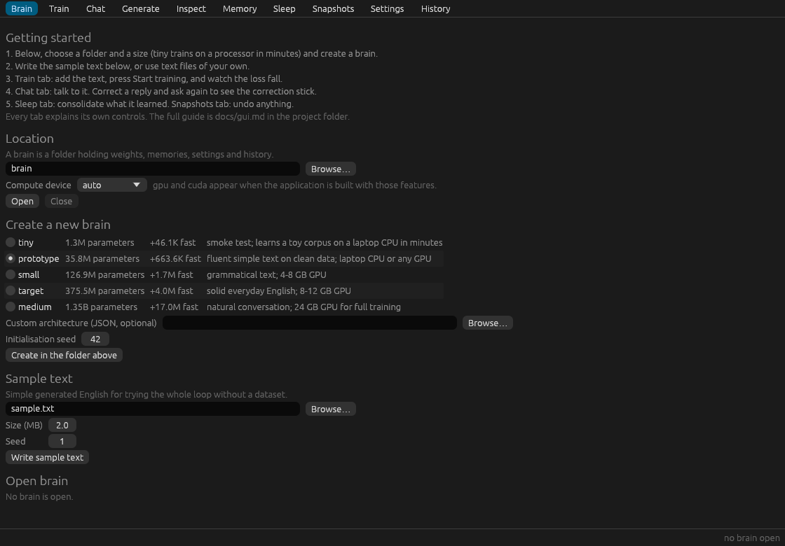

With a brain open, the bottom of the tab describes it:

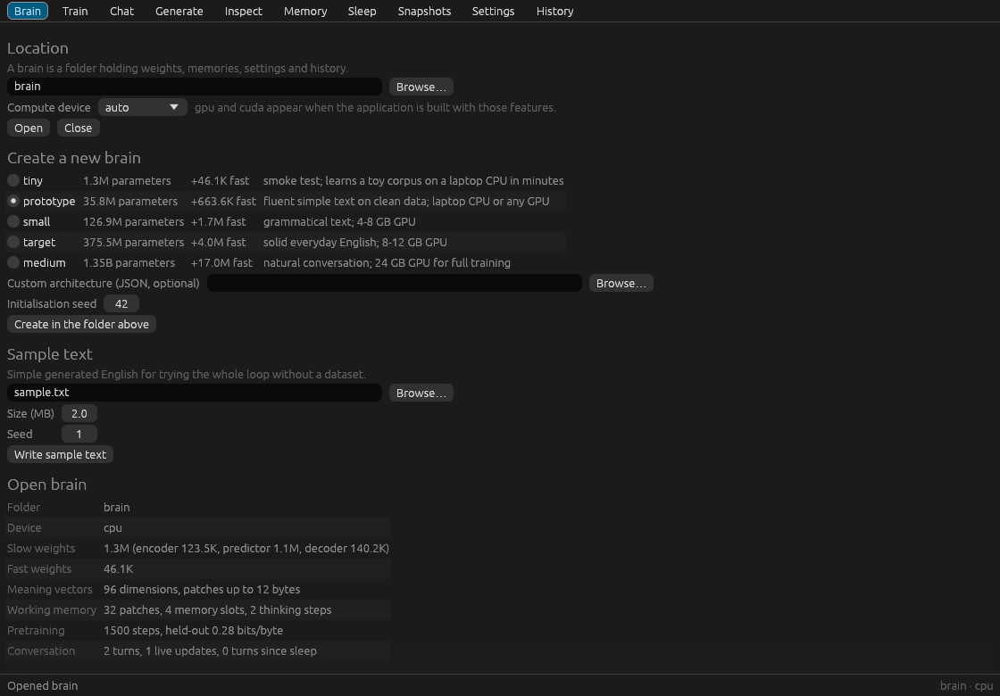

- **Location**: the brain folder (type it or use *Browse…*) and the compute
  device. *Open* opens an existing brain; *Close* closes it.
- **Create a new brain**: pick a size, or give a JSON file with a custom
  architecture, choose a seed, and press *Create in the folder above*. The
  table shows each size's parameter count and what to expect from it.
- **Sample text**: writes a file of simple generated English for trying the
  whole loop without a dataset.
- **Open brain**: sizes, pretraining steps, conversation turns, sleeps,
  memories, snapshots and replay data. It refreshes after every operation.

## Train tab

Pretrain on text files, watch the losses, and measure held-out text.

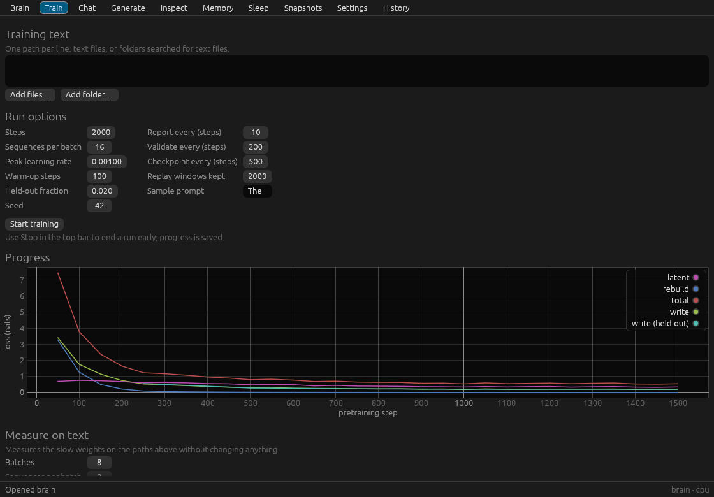

- **Training text**: one path per line (files, or folders that are searched
  for files), or use *Add files…* and *Add folder…*.
- **Run options**: steps, batch size, learning rate, warm-up, held-out
  fraction, seed, and how often to report, validate and save. They are the
  same options as `thingamaroo train`; see [cli.md](cli.md#train).
- **Start training** begins a run. Training again later continues from where
  the last run stopped.
- **Progress**: a progress bar with speed and learning rate, the loss curves
  over all pretraining steps this brain has ever taken, the latest held-out
  measurement, and a sample of what the model currently writes.
- **Measure on text**: measures the slow weights on the paths above without
  changing anything, and reports the losses, the rebuild accuracy and the
  spread of the meaning vectors.

The curves are explained under [Reading the numbers](cli.md#reading-the-numbers).

## Chat tab

Talk to the brain while it remembers and learns.

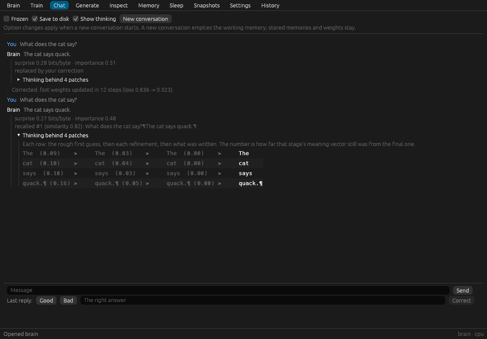

- **Options** (applied when a conversation starts):
  - *Frozen*: read-only conversation, no weight updates and no memory writes.
  - *Save to disk*: when off, what is learned lasts only for this session.
  - *Show thinking*: record what each thinking stage would have written.
- **New conversation** empties the working memory. Stored memories and weights stay.
- **Message** box: type and press Enter or *Send*. The first message starts a
  conversation with the current options.
- Under each reply, a grey line reports the surprise of your message, its
  importance, which memories were recalled, whether the exchange was stored,
  and whether the fast weights were updated. *Thinking behind N patches* opens
  the coarse-to-fine trace: each row is one patch, from the rough first guess
  through each refinement to what was written, with the distance of each
  stage's meaning vector from the final one.
- **Last reply**: *Good* reinforces it, *Bad* forgets the exchange, and typing
  the right answer and pressing *Correct* replaces the reply and teaches it.

In the screenshot the brain first answered "The cat says meow.", was corrected
to "The cat says quack.", and gave the corrected answer when asked again.

While a learning conversation sits idle, the brain goes to sleep on its own
when the schedule in **Settings** says so.

## Generate tab

Continue a prompt without memory or learning.

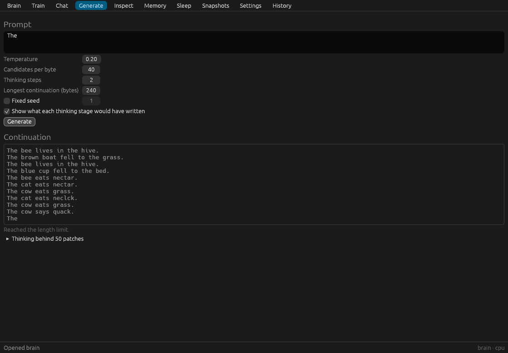

Set the prompt, temperature, candidates per byte, thinking steps and the
longest continuation; tick *Fixed seed* to make the result repeatable. The
options start from the open brain's `generation.*` settings. The text appears
as it is written, and the thinking trace is shown below it.

## Inspect tab

See how text is patched and what survives a trip through meaning space.

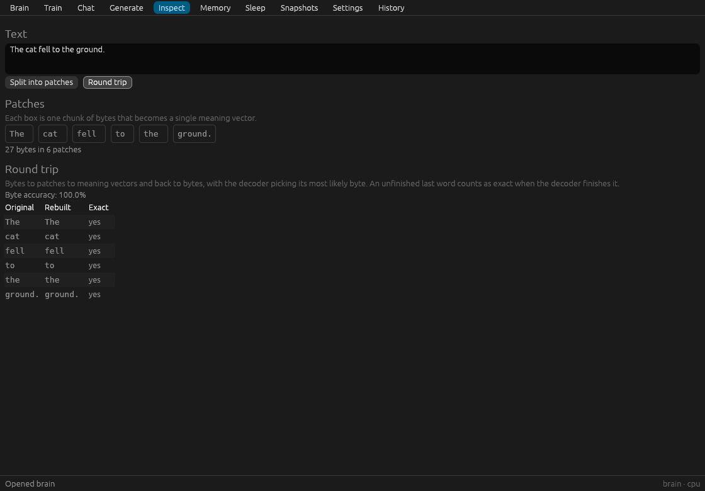

- **Split into patches** shows each chunk of bytes that becomes one meaning vector.
- **Round trip** encodes the text and decodes it again with the decoder's most
  likely bytes, patch by patch, and reports the byte accuracy.

## Memory tab

Browse, search, add and delete episodic memories.

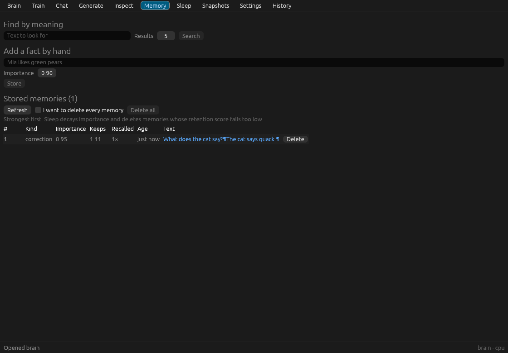

- **Find by meaning** lists the memories closest to a text. Click one to see it in full.
- **Add a fact by hand** stores a note with the importance you choose.
- **Stored memories** lists every memory, strongest first, with its kind,
  importance, retention score ("keeps"), recall count and age. *Delete* removes
  one; ticking *I want to delete every memory* enables *Delete all*.

## Sleep tab

Consolidate memories into the slow weights and see what happened.

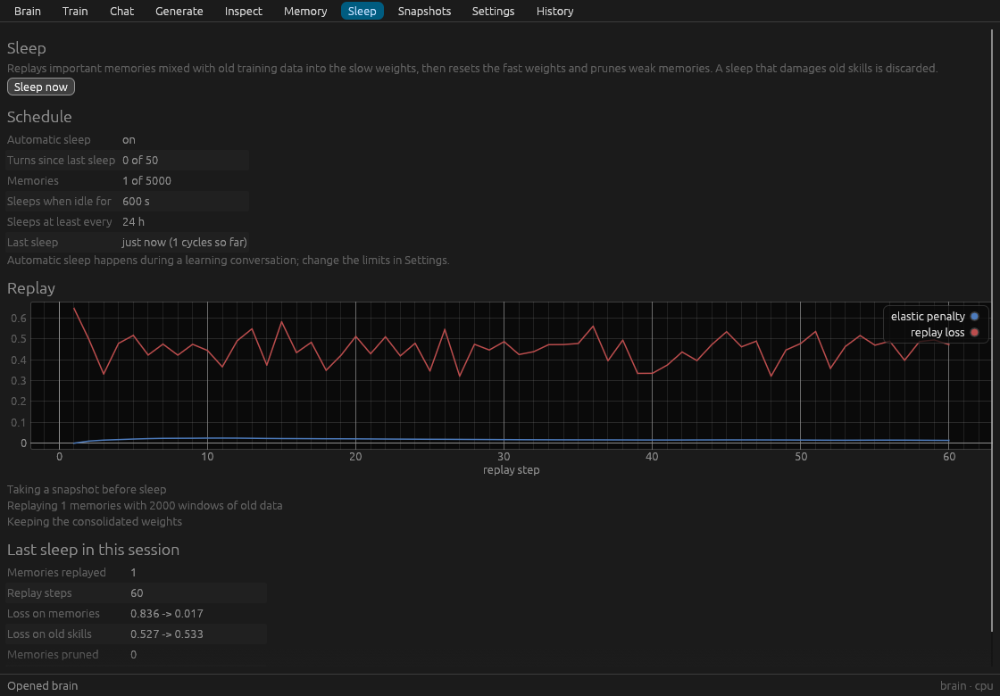

- **Sleep now** runs one sleep cycle.
- **Schedule** shows how close the brain is to sleeping on its own.
- **Replay** plots the replay loss and the elastic penalty step by step.
- **Last sleep in this session** reports how many memories were replayed, the
  loss on memories and on old skills before and after, how many memories were
  pruned, and which snapshot holds the weights from before the sleep.

A sleep that damages old skills is discarded; the tab says so in orange.

## Snapshots tab

Save weights, roll back, and reset the fast weights.

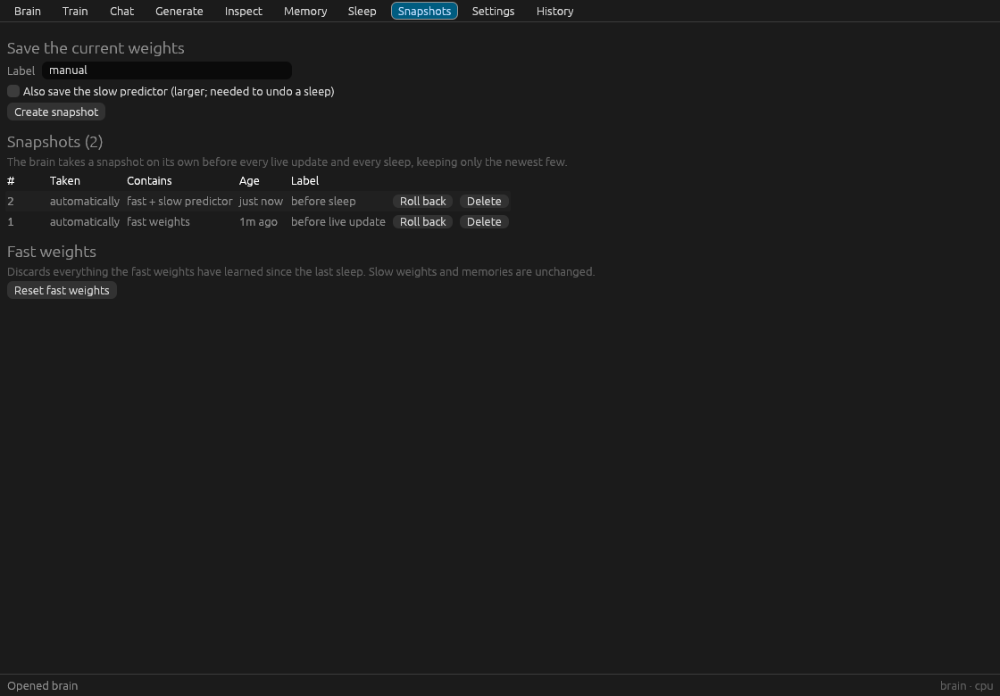

- **Save the current weights** creates a snapshot with a label. Tick *Also save
  the slow predictor* to be able to undo a sleep with it.
- **Snapshots** lists them newest first, with *Roll back* and *Delete* on each row.
- **Reset fast weights** discards what the fast weights have learned since the
  last sleep.

## Settings tab

View and change every adjustable behaviour.

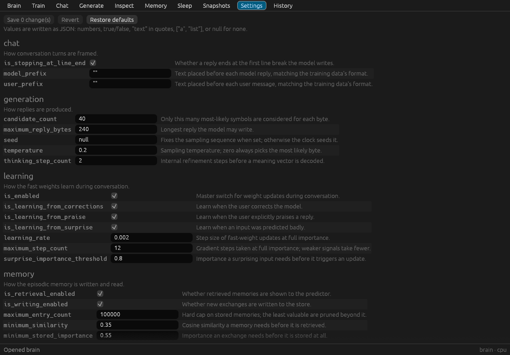

Every setting is listed with its current value and an explanation. Switches are
check boxes; everything else is a text field holding JSON (a number,
`"text"`, `["a", "list"]`, or `null` for none). Changed settings turn bold.
*Save N change(s)* writes them, *Revert* drops your edits, and *Restore
defaults* resets everything.

[settings.md](settings.md) has the same list with the defaults.

## History tab

The record of training, live updates and sleep, newest first.

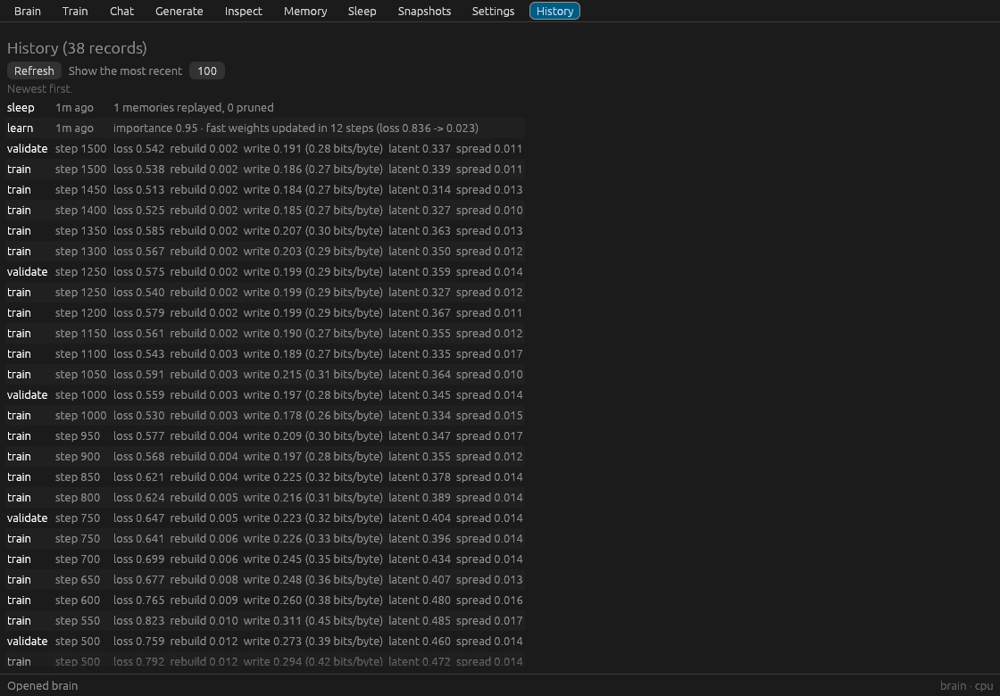

## Command-line equivalents

| Command line | Desktop application |
| --- | --- |
| `--brain`, `--device` | Brain tab → Location |
| `presets` | Brain tab → Create a new brain (the size table) |
| `init` | Brain tab → Create a new brain |
| `sample-corpus` | Brain tab → Sample text |
| `status` | Brain tab → Open brain |
| `train` | Train tab → Start training |
| `evaluate` | Train tab → Measure on text |
| `patches` | Inspect tab → Split into patches |
| `roundtrip` | Inspect tab → Round trip |
| `generate` (with `--thoughts`) | Generate tab |
| `chat` | Chat tab |
| `chat --frozen`, `--no-save`, `--thoughts` | Chat tab → Frozen, Save to disk, Show thinking |
| `/correct`, `/good`, `/bad` | Chat tab → Correct, Good, Bad |
| `/forget` | Chat tab → New conversation |
| `memory list`, `memory show` | Memory tab → Stored memories (click a row) |
| `memory search` | Memory tab → Find by meaning |
| `memory add` | Memory tab → Add a fact by hand |
| `memory delete`, `memory clear` | Memory tab → Delete, Delete all |
| `sleep` | Sleep tab → Sleep now |
| `snapshot create`, `snapshot list`, `snapshot rollback`, `snapshot delete` | Snapshots tab |
| `reset-fast-weights` | Snapshots tab → Reset fast weights |
| `settings show`, `settings set`, `settings reset` | Settings tab |
| `settings reference` | Settings tab (explanations beside each setting) and [settings.md](settings.md) |
| `history` | History tab |
| Ctrl-C | Stop button |

## Troubleshooting

**The window does not open.** Start it from a terminal to see the reason. Try
`thingamaroo-gui --renderer glow`. On Linux the window needs the usual desktop
libraries; on a minimal installation the one most often missing is
`libxkbcommon-x11` (Debian/Ubuntu: `sudo apt install libxkbcommon-x11-0`).

**Browse… does nothing (Linux).** The file chooser is provided by the desktop's
portal service (`xdg-desktop-portal`). Without it, type or paste the path
instead; every path field accepts typing.

**libtorch, gpu or cuda is missing from the device list.** The application was
built without that feature (`libtorch` is missing from a pure-Rust build). See [Building](../README.md#building).

**"episodic memory store: ... already open".** The brain is open in another
application (for example a `thingamaroo chat` session). A brain can be used by
one application at a time; close the other one and press *Open* again.

**Everything is slow.** The processor devices (`libtorch`, and `cpu`, which is
about half as fast) are meant for the `tiny` size and for trying things out.
Larger sizes need a build with `--features gpu` or `cuda`.

**The application does not start: `libtorch_cpu.so` (or a LibTorch `.dll`) is
missing.** LibTorch was moved or deleted since the build, or, on Windows, its
`lib` folder is not on `PATH`. See [Building](../README.md#libtorch-on-by-default).
